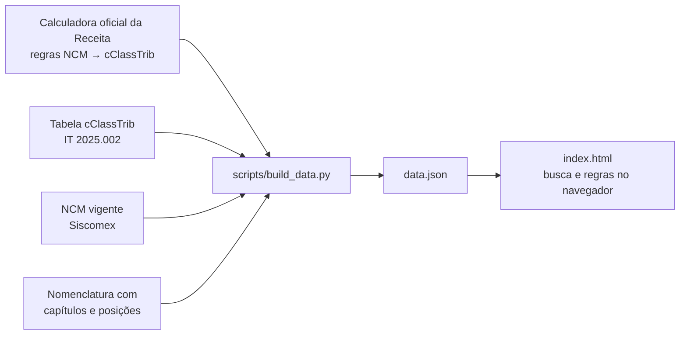

# Consulta NCM para IBS e CBS

Ferramenta web que responde à pergunta mais comum na adequação dos ERPs à Reforma Tributária: **como este produto fica no IBS e na CBS?**

Você digita o NCM (ou o nome do produto) e a ferramenta mostra:

- o **regime**: alíquota zero, redução de 30% ou 60%, diferimento ou tributação integral;
- o **CST** e o **cClassTrib** a usar na NF-e, com o artigo da LC 214/2025 e o texto do anexo;
- **todos os enquadramentos possíveis** quando eles dependem da operação ou de quem compra (por exemplo, venda à administração pública ou insumo agropecuário);
- o grupo **IBSCBS do XML** já preenchido (NT 2025.002), com botão para copiar;
- uma **simulação de valores** para 2026 (ano de teste) e 2027 (início da cobrança da CBS);
- o aviso de **Imposto Seletivo**, quando o produto estiver sujeito a ele.


## Como funciona



1. **Coleta** (`scripts/baixar_fontes.sh`): baixa as tabelas oficiais.
2. **Transformação** (`scripts/build_data.py`): filtra o que está vigente, normaliza as regras de aplicação por NCM e gera um único `data.json` (~1 MB).
3. **Consulta** (`index.html`): página estática, sem servidor. O cruzamento NCM → regras é feito no navegador.

### Regras de negócio implementadas

- **Regra geral:** sem enquadramento em anexo, o item usa CST `000` e cClassTrib `000001` (tributação integral).
- **Casamento por prefixo:** cada regra vale para um prefixo de NCM (2 a 8 dígitos), menos as exceções listadas.
- **União das exceções:** a fonte oficial repete a mesma regra em várias linhas, cada uma com uma exceção diferente. O script junta essas exceções. Sem esse tratamento, um NCM excluído numa linha voltaria pela linha vizinha: o arroz da cesta básica (Anexo I, alíquota zero) apareceria também no Anexo VII (redução de 60%), que o exclui expressamente.
- **Ordem de exibição:** primeiro os enquadramentos sem condição especial; depois os que dependem do destino ou do comprador (insumo agropecuário, diferimento, administração pública). A alíquota zero prevalece sobre a redução (art. 7º-A da LC 214).
- **Alíquota efetiva:** `alíquota × (1 − redução)`, aplicada a CBS, IBS estadual e IBS municipal.

## Fontes de dados

| Dado | Fonte | Versão usada |
| --- | --- | --- |
| Regras NCM → cClassTrib, reduções e textos dos anexos | Calculadora de Tributos da Reforma (Receita Federal), módulo offline V0059, via pacote [`@sinete/ibs-cbs-dados`](https://www.npmjs.com/package/@sinete/ibs-cbs-dados) (Apache-2.0) | conhecida em 30/09/2026 |
| Tabela cClassTrib e CST | Informe Técnico 2025.002 | v1.60 |
| NCMs de 8 dígitos vigentes | Siscomex, via pacote [`@br-validators/core`](https://www.npmjs.com/package/@br-validators/core) (MIT) | 20/09/2026 |
| Capítulos, posições e subposições | Nomenclatura do portal Classif (Siscomex) | ver rodapé da página |

## Rodar localmente

```bash
python -m http.server 8000
# abra http://localhost:8000
```

A página carrega o `data.json` por `fetch`, então precisa ser servida por HTTP (abrir o arquivo direto no navegador não funciona).

## Atualizar os dados

```bash
./scripts/baixar_fontes.sh
python scripts/build_data.py \
  --sinete fontes/sinete/package/src/data \
  --ncm-map fontes/brv/package/dist/ncm.js.map \
  --hierarquia fontes/ncm_siscomex.json \
  --saida data.json
```

## Limitações

- **Informativa:** não substitui análise fiscal. Confirme na tabela oficial vigente antes de parametrizar um sistema.
- A tabela cClassTrib usada é a v1.60. Versões posteriores (até a 1.71, de out/2026) mudaram principalmente operações não onerosas e doações, que não afetam a consulta por NCM.
- Alguns enquadramentos dependem da operação ou do adquirente. A ferramenta mostra todos, mas a escolha final é de quem conhece a operação.
- As alíquotas de 2027 seguem o cálculo do TCU (CBS de 11,3% de referência, 11,2% efetiva), ainda sujeito à resolução do Senado.

## Tecnologias

Python (pipeline de dados) · HTML, CSS e JavaScript puro (interface) · dados públicos oficiais.

## Autor

**Anselmo Xavier** · Anselmo Tech. 15 anos com ERP, NF-e e SQL, hoje focado em Reforma Tributária e engenharia de dados.

## Licença

Código sob licença MIT (veja `LICENSE`). Os dados seguem as licenças das fontes (veja `NOTICE.md`).
