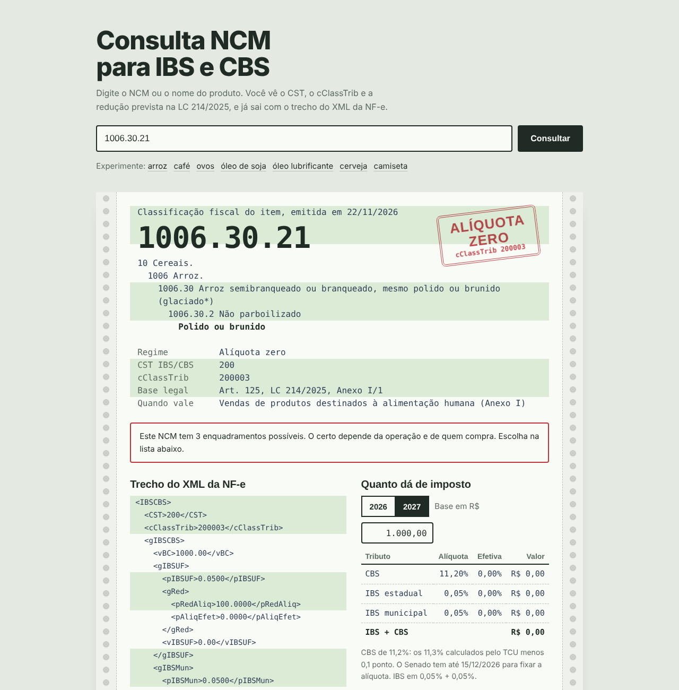
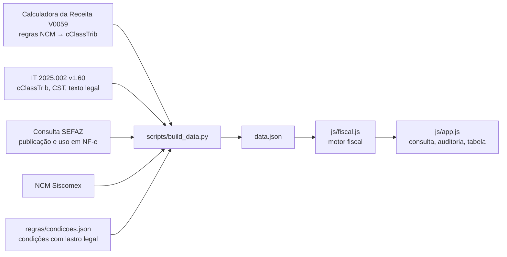

# Consulta NCM para IBS e CBS

Ferramenta web para quem implanta ERP na Reforma Tributária. Ela responde a duas perguntas:

1. **Para este produto, nesta operação e nesta data, quais enquadramentos de IBS/CBS precisam ser considerados, e por quê?**
2. **Dos produtos cadastrados no meu ERP, quais precisam de revisão, por qual motivo e o que devo conferir antes do go-live?**

No ar em **https://consultancm.anselmotech.com.br**.



## O que tem

- **Consultar produto:** busca por NCM ou descrição, com escolha entre produtos parecidos. Informe a data e o tipo de operação. O resultado mostra:
  - o diagnóstico;
  - os enquadramentos com CST e cClassTrib, redução, condições, base legal, fonte, versão e vigência;
  - as perguntas que faltam responder;
  - o trecho do XML (grupo IBSCBS) com os campos ainda indefinidos marcados como `[PENDENTE]`.
- **Auditar cadastro:** importa um CSV do ERP (vírgula ou ponto e vírgula). O fluxo é este:
  1. mostra uma amostra do arquivo e pede para mapear as colunas;
  2. pede a data e a operação do lote;
  3. analisa linha a linha e mostra os totais por situação, com filtros e o detalhe de cada item;
  4. exporta um CSV com a linha original de cada item, para achar o produto no arquivo do ERP.
- **Tabela cClassTrib:** os 164 códigos com busca, filtro por CST e data de vigência, e download da planilha.

As situações da auditoria são:

| Situação | Quando |
| --- | --- |
| Divergência encontrada | NCM ausente, malformado ou fora da tabela; CST ou cClassTrib inexistente, fora de vigência, fora da NF-e ou incompatíveis entre si; código que contradiz a regra da base |
| Requer confirmação | O enquadramento depende de condição não informada (comprador, diferimento, registro na Anvisa) ou há mais de um enquadramento possível |
| Sem cobertura | Data anterior à vigência, operação fora do escopo, código que não dá para verificar pelo NCM |
| Sem divergência nas verificações executadas | As checagens acima não acharam problema |

## Princípios

- **Não presume tributação.** Se a base não tem regra para o NCM, a tela mostra *"Sem regra localizada na base consultada"* e deixa CST e cClassTrib como pendentes. Ela não escreve `000001`.
- **Não confirma benefício condicionado.** Quando a regra depende do comprador, do diferimento ou do registro na Anvisa, a tela pergunta. O benefício só aparece como aplicável depois da resposta.
- **Nada inventado.** Códigos, reduções, vigências e textos legais vêm das fontes oficiais. As condições ficam em `regras/condicoes.json`. Cada uma cita o trecho da lei que a justifica, e o build falha se esse trecho não existir no texto da fonte.
- **Vigência pela data da operação.** Regras, exceções, reduções e códigos guardam início e fim de vigência. A data de publicação aparece separada.
- **Uma regra só.** `js/fiscal.js` é o mesmo motor para a consulta e para o CSV. Mesmos dados dão o mesmo diagnóstico (há teste para isso).

## Como funciona



| Arquivo | Papel |
| --- | --- |
| `index.html`, `css/app.css`, `fonts/` | Página, estilos e fontes locais |
| `js/fiscal.js` | Motor fiscal: normalização, vigência, compatibilidade, condições, diagnóstico, XML, auditoria em lote |
| `js/csv.js` | Leitura e escrita de CSV sem converter para número (zeros à esquerda preservados) |
| `js/app.js` | Interface |
| `regras/condicoes.json` | Operações cobertas e condições, cada uma com trecho da lei |
| `exemplos/cadastro-demonstracao.csv` | Cadastro **fictício** de demonstração |
| `scripts/build_data.py` | Gera o `data.json` a partir das fontes |
| `tests/` | Testes (`node --test`) |
| `vercel.json`, `.vercelignore` | Cabeçalhos de segurança e o que vai para o ar |

## Fontes de dados

| Dado | Fonte | Versão usada |
| --- | --- | --- |
| Regras NCM → cClassTrib, reduções datadas, texto legal, anexos | Calculadora de Tributos da Reforma (RFB), módulo offline V0059, e IT 2025.002 v1.60, pelo pacote [`@sinete/ibs-cbs-dados`](https://www.npmjs.com/package/@sinete/ibs-cbs-dados) (Apache-2.0) | dados de 30/09/2026 |
| Data de publicação e uso em NF-e de cada cClassTrib e CST | Serviço de consulta da tabela de classificação tributária (SEFAZ), resposta salva no projeto [`souzamonteiro/nfeemissor`](https://github.com/souzamonteiro/nfeemissor) (Apache-2.0) | publicação de 22/06/2026 |
| NCMs de 8 dígitos | Siscomex, pelo pacote [`@br-validators/core`](https://www.npmjs.com/package/@br-validators/core) (MIT) | 20/09/2026 |
| Capítulos e posições | Nomenclatura do portal Classif (Siscomex) | ver rodapé da página |

## Cobertura real desta versão

- **Operações:** venda no mercado interno, venda à administração pública e venda a entidade de saúde imune com CEBAS. Exportação, devolução e remessa aparecem como *Sem cobertura*.
- **Datas:** a partir de 01/01/2026, início das vigências na base. Datas anteriores ficam *Sem cobertura*. Mudanças publicadas depois das versões acima não estão refletidas.
- **Enquadramentos por NCM:** os 17 cClassTrib ligados a NCM na Calculadora (anexos I, IV, V, VI, VII, VIII, IX, X, XI, XII, XIII e XV, além do diferimento de insumos agropecuários). Para NCMs fora deles, a resposta é "sem regra localizada".
- **Condições perguntadas:** o comprador (administração pública ou entidade com CEBAS), o diferimento do art. 138, § 2º, a produção nacional artística (art. 139), o sócio brasileiro (art. 142, II) e os itens de anexo cujo texto traz destinação.
- **Medicamentos (posições 30.03 e 30.04):** dependem do registro na Anvisa e de listas por princípio ativo, que a base não liga a NCM. A tela pede confirmação e não aponta benefício.
- **Fora do escopo:** Imposto Seletivo (só avisa), importação de XML, monitoramento de mudanças de tabela e simulação de valores para lançamento. A simulação da tela usa alíquotas de **referência**: as de 2026 são as do período de teste; a de 2027 é estimativa, ainda não oficial.

## Rodar, testar e atualizar

```bash
python -m http.server 8000      # abra http://localhost:8000
npm test                        # testes do motor e do CSV (Node 20+)
npm run lint                    # checagem de sintaxe e dos JSON
./scripts/baixar_fontes.sh      # baixa as fontes para fontes/
npm run build:dados             # gera o data.json e confere o lastro das condições
```

### Demonstração da auditoria

1. Abra a página e toque em **Auditar cadastro**.
2. Toque em **Usar cadastro de demonstração** (cadastro fictício) ou importe `exemplos/cadastro-demonstracao.csv`.
3. Confira o mapeamento das colunas e escolha a data do lote (ex.: 01/12/2026). Depois toque em **Analisar cadastro**.
4. Toque nos totais para filtrar e abra um item para ver o valor recebido, o motivo, a referência e a ação.
5. Use **Abrir este item na consulta** para ver o mesmo diagnóstico na tela de consulta.
6. **Baixar resultado em CSV** gera o arquivo com a linha original de cada item.

## Segurança

O site é estático e o CSV do usuário é lido só no navegador (não vai para servidor). Mesmo assim:

- **Sem XSS:** todo texto vindo do CSV, da busca ou da URL é escapado antes de virar HTML. Links só saem para `https://*.gov.br`.
- **CSP restritiva** (`vercel.json`): só scripts, estilos e fontes do próprio site; nenhum script ou estilo inline; o site não pode ser embutido em iframe. Também `nosniff`, `Referrer-Policy`, `Permissions-Policy` e COOP/CORP.
- **Sem terceiros:** as fontes (OFL) ficam em `fonts/`; nenhuma requisição sai para outros domínios, nem analytics.
- **Exportação sem injeção de fórmula:** células que começam com `=`, `+`, `-`, `@`, TAB ou CR recebem um apóstrofo antes de ir para o CSV, para não virarem fórmula no Excel.
- **Integridade dos dados:** as fontes têm versão fixa e SHA-256 conferido em `scripts/baixar_fontes.sh`; o build falha se uma condição não tiver lastro no texto legal ou se um link não for oficial, e registra o SHA-256 de cada entrada em `data.json` (`versoes.hashes`).
- **Só o necessário no ar:** `.vercelignore` tira scripts, testes e arquivos internos da publicação. Limite de 20 MB no CSV importado.

## Limitações

- Ferramenta informativa: não substitui a análise fiscal.
- A tabela cClassTrib usada é a v1.60. Versões posteriores mudaram sobretudo operações não onerosas e doações.
- A tabela NCM é um retrato de 20/09/2026, sem histórico de vigência por código.

## Autor

**Anselmo Xavier**, Anselmo Tech. 15 anos com ERP, NF-e e SQL; hoje focado em Reforma Tributária e engenharia de dados.

## Licença

Código sob licença MIT (veja `LICENSE`). Os dados seguem as licenças das fontes (veja `NOTICE.md`).
